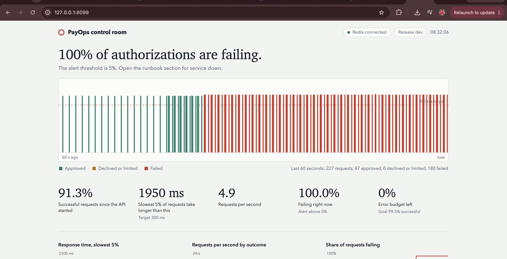

# PayOps Reliability Toolkit

Monitoring, incident response and root-cause analysis for a **simulated** payment-authorization service.
The service does not process real payments; it exists so there is a realistic system to monitor, break, fix and document
the way a technology operations team does.

## What is in here
- **Service under watch** (`app/`): FastAPI `POST /authorize` backed by Redis (rate limit, card velocity, idempotency) and a
  simulated downstream risk scorer. Fails closed when Redis is down. Exposes `/health`, `/ready` and Prometheus `/metrics`.
- **Monitoring** (`monitoring/`, `docker-compose.yml`): Prometheus, Alertmanager, Grafana dashboard, node-exporter,
  blackbox probe, and a webhook sink that prints alerts. Alert rules cover service down, Redis down, error rate, p95 latency,
  disk and CPU.
- **Health and network checker** (`scripts/healthcheck.py`): DNS, TCP port, HTTP readiness, a synthetic authorization
  with a latency threshold, Redis reachability, and host CPU, memory and disk. JSON output and exit codes 0/1/2.
- **Maintenance automation** (`scripts/`): Redis backup with checksum and retention, restore test that loads the backup into a
  scratch Redis and compares key counts, log cleanup and a pending-update report, and `deploy.sh` with post-deploy
  health check and automatic rollback.
- **Live control-room dashboard** (`app/static/`, served at `/`): plain HTML, CSS and JavaScript with no build step.
  It reads the API's own `/metrics`, `/api/status` and `/api/drills`, and shows a one-sentence service status, a live tape of
  authorizations, availability, latency and error-budget figures, trend charts, an event log, test-traffic and fault controls,
  and the measured drill results.
- **Failure drills** (`drills/run_drill.py`): Redis outage, blocked port, disk full, high latency, bad deploy. Each drill
  records time to detect, time to recover and failed requests.
- **Documentation** (`docs/`): runbook, SLOs, configuration reference, five RCA reports and an RCA template.

```
 load generator --> payops-api (:8099) --> Redis
                       |  \--> simulated risk scorer
                       |  /metrics
   blackbox probe -----+--> Prometheus --> Alertmanager --> alert sink / Slack
   node-exporter -----/          |
                              Grafana dashboard
```

## Run it
Local, no Docker (needs Python 3.10+ and `redis-server`):
```bash
pip install -r requirements.txt
python -m pytest -q                      # 17 tests: API against a real Redis, checker, dashboard logic (needs node)
python drills/run_drill.py all           # needs root: uses iptables and a tmpfs mount
python drills/make_rca.py                # regenerates docs/RESULTS.md and docs/rca/ from the measured results
```
Dashboard (the fastest way to see it working):
```bash
redis-server --port 6379 --daemonize yes
ENABLE_FAULT_INJECTION=1 uvicorn app.main:app --port 8099
# open http://localhost:8099 , press "Start test traffic", then slow the risk scorer or run: redis-cli shutdown nosave
```
Screenshots taken from a real run are in `docs/screenshots/` (normal, slow risk scorer, Redis down).

Full monitoring stack:
```bash
docker compose up -d --build
# Grafana http://localhost:3000 (admin/admin) -> dashboard "PayOps Reliability"
# Trigger a fault: docker compose stop redis   (watch alerts: docker compose logs -f alert-sink)
```

## Results
Measured drill results are in [docs/RESULTS.md](docs/RESULTS.md) and `drills/results/drills.csv`; each incident has an RCA in
`docs/rca/`.

## Dashboard


Everything on the page comes from the running service: the figures and charts are computed in the browser from `/metrics`,
the tape shows the requests the page itself sends, and the drill table reads `drills/results/results.json`.
Fault controls call `POST /admin/fault`, which only works when the API starts with `ENABLE_FAULT_INJECTION=1`.

## Honest scope notes
- The payment service, traffic and downstream scorer are simulated.
- The drill script applies each fix immediately after detection, so recovery times are a lower bound; a person following the
  runbook will be slower. Re-run the steps by hand to measure your own response time.
- The dashboard was exercised in headless Chrome against a live API: normal traffic, a slowed risk scorer, a real Redis outage
  and recovery, and a phone-width layout. Its figures cover the time since the API process started; they are not a
  replacement for Prometheus and Grafana.
- The page limits itself to 5 requests in flight (browsers allow about 6 per host), so when responses are slow it sends
  fewer requests per second instead of queueing requests that would time out in the browser.
- The Docker Compose, Prometheus, Alertmanager and Grafana configuration files were syntax-checked but not started in the
  environment where this repository was generated. Run `docker compose up` and check the dashboard and alerts yourself,
  and add screenshots to the repository.
- Known gaps listed in the RCAs (blue/green deploys, parallel health checks, Redis replica) are not implemented.
